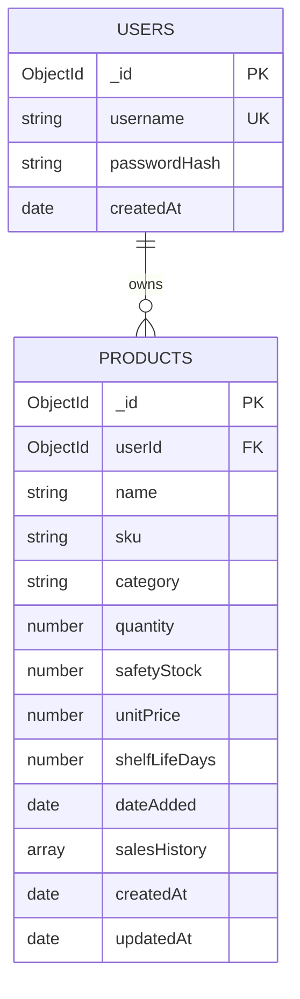

# VeggieTrack (Veggie Stock Management)

A full-stack vegetable inventory and analytics app for small and mid-sized produce businesses.
It provides authentication, stock CRUD, shelf-life tracking, dashboard metrics, and chart-based insights.

## Project Overview

- Frontend: React + Vite single-page app with route-based pages (`/dashboard`, `/inventory`, `/insights`, etc.)
- Backend: Node.js + Express REST API for auth and product operations
- Database: MongoDB with Mongoose models (`User`, `Product`)
- Auth: JWT-based login/register on backend, with local fallback logic in frontend for offline/demo behavior

## Complete Tech Stack

### Frontend

- React 19
- Vite 8
- React Router DOM 7
- Chart.js 4 + react-chartjs-2
- ESLint 9
- CSS (custom styles in `frontend/src/styles`)

### Backend

- Node.js
- Express 4
- Mongoose 7
- bcryptjs (password hashing)
- jsonwebtoken (JWT auth)
- cors
- dotenv
- nodemon (dev)

### Database

- MongoDB
- Mongoose ODM

### Storage/Session Notes

- JWT token stored in `localStorage` (`veggie_auth_token`)
- Session UI flags in `sessionStorage` (`isLoggedIn`, `username`, `isAdmin`)
- Local inventory/user fallback also exists in `localStorage` (`veggie_stock_*`, `veggie_users`) if backend is unavailable

## Database Design

### Collections

#### 1) `users`

| Field | Type | Constraints |
|---|---|---|
| `_id` | ObjectId | Primary key |
| `username` | String | Required, unique, lowercase, trimmed |
| `passwordHash` | String | Required |
| `createdAt` | Date | Default: `Date.now` |

#### 2) `products`

| Field | Type | Constraints |
|---|---|---|
| `_id` | ObjectId | Primary key |
| `userId` | ObjectId | Required, ref -> `users._id` |
| `name` | String | Required |
| `sku` | String | Required |
| `category` | String | Required |
| `quantity` | Number | Required, default `0` |
| `safetyStock` | Number | Required, default `1` |
| `unitPrice` | Number | Required, default `0.0` |
| `shelfLifeDays` | Number | Required, default `7` |
| `dateAdded` | Date | Default: `Date.now` |
| `salesHistory[].date` | String | Required |
| `salesHistory[].sold` | Number | Required |
| `createdAt` | Date | Auto (`timestamps: true`) |
| `updatedAt` | Date | Auto (`timestamps: true`) |

### ER Diagram



## Backend API Overview

Base URL: `http://localhost:5000/api`

### Auth

- `POST /auth/register` -> register user and return JWT
- `POST /auth/login` -> login and return JWT

### Products (JWT required)

- `GET /products` -> list products for logged-in user
- `POST /products` -> create product
- `GET /products/:id` -> get one product
- `PUT /products/:id` -> update product
- `DELETE /products/:id` -> delete product

Send token in header:

```http
Authorization: Bearer <token>
```

## File Structure

### Root

```text
veggie-stock-management/
|-- backend/
|-- frontend/
|-- README.md
```

### Backend Structure

```text
backend/
|-- models/
|   |-- Product.js
|   |-- User.js
|-- routes/
|   |-- auth.js
|   |-- products.js
|-- .env
|-- package.json
|-- package-lock.json
|-- server.js
```

### Frontend Structure

```text
frontend/
|-- public/
|-- src/
|   |-- components/
|   |   |-- Sidebar.jsx
|   |-- pages/
|   |   |-- AdminPage.jsx
|   |   |-- DashboardPage.jsx
|   |   |-- HomePage.jsx
|   |   |-- InsightsPage.jsx
|   |   |-- InventoryPage.jsx
|   |   |-- LoginPage.jsx
|   |   |-- TermsPage.jsx
|   |-- styles/
|   |-- utils/
|   |   |-- AuthContext.jsx
|   |   |-- data.js
|   |-- App.jsx
|   |-- main.jsx
|-- package.json
|-- vite.config.js
```

## Run Locally (Backend + Frontend)

## 1) Prerequisites

- Node.js 18+ (recommended)
- npm 9+
- MongoDB running locally or cloud URI

## 2) Backend Setup

Go to backend folder:

```powershell
cd "C:\Users\thehu\Desktop\NEW FSD\veggie-stock-management\backend"
```

Install dependencies:

```powershell
npm install
```

Create `.env` in `backend/`:

```env
MONGO_URI=mongodb://127.0.0.1:27017/veggieTrackDB
JWT_SECRET=replace-with-strong-secret
PORT=5000
```

Start backend dev server:

```powershell
npm run dev
```

Backend runs on: `http://localhost:5000`

## 3) Frontend Setup

Open new terminal, then:

```powershell
cd "C:\Users\thehu\Desktop\NEW FSD\veggie-stock-management\frontend"
npm install
npm run dev
```

Frontend runs on: `http://localhost:5173`

## 4) Important Integration Note

Current frontend API base is hardcoded in `frontend/src/utils/data.js`:

```js
const API_BASE_URL = 'http://localhost:5000/api';
```

So backend should stay on port `5000` unless you also update this value.

## Scripts

### Backend (`backend/package.json`)

- `npm run dev` - start with nodemon
- `npm start` - start with node

### Frontend (`frontend/package.json`)

- `npm run dev` - start Vite dev server
- `npm run build` - production build
- `npm run preview` - preview build
- `npm run lint` - run ESLint

## Current Architecture Notes

- This repo contains both:
  - modern React frontend in `frontend/`
  - legacy static assets in root `assets/`
- Backend currently serves static files from repo root as a generic fallback, while React app is typically run via Vite during development.
- Auth and product data primarily use backend API, but frontend includes local fallback behavior for demo/offline scenarios.
